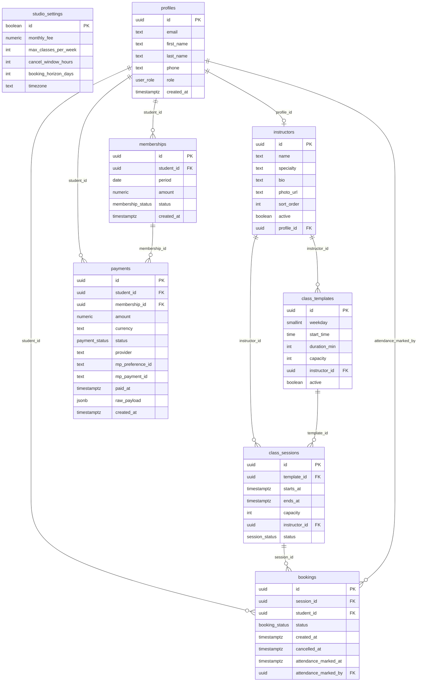

# Casa Pilates

Sitio web de un estudio de pilates: presentación del estudio, reserva de clases por semana,
pago de la mensualidad con Mercado Pago, historial de clases y asistencia, y un panel de administración.

Proyecto de la materia Programación Web (ITBA).

- **Sitio publicado:** https://programacion-web-theta-orpin.vercel.app
- **Preview de cada PR:** lo genera Vercel automáticamente y aparece como comentario en el PR.

## Qué incluye

| Área | Rutas | Quién |
|---|---|---|
| Institucional | `/`, `/nosotros`, `/profesoras`, `/estudio`, `/contacto` | Todos |
| Alumnas | `/app/reservar`, `/app/mis-clases`, `/app/pagos`, `/app/cuenta` | Alumnas con sesión |
| Panel | `/admin` (agenda en calendario, clase, horarios, alumnas con métricas) | Admin y profesoras (las altas y cancelaciones, solo admin) |

Reglas del estudio: clases de 1 hora con cupo limitado, máximo 3 clases por semana por alumna,
cancelación sin costo hasta 12 horas antes (después, la clase se descuenta), y reservas solo con el mes pagado.

## Tecnologías

- **Frontend:** React 19 + TypeScript + Vite, React Router, CSS Modules y variables CSS (sin frameworks de estilos).
- **Backend:** Supabase (Postgres, Auth y Edge Functions). Los permisos los aplica la base con RLS,
  y las reglas de reservas viven en funciones SQL (`book_session`, `cancel_booking`, `mark_attendance`).
- **Pagos:** Mercado Pago Checkout Pro.
- **Publicación:** Vercel. **CI:** GitHub Actions.

## Cómo correrlo

Requisitos: Node.js 24 (las pruebas usan TypeScript sin compilar, que Node 24 soporta).

```bash
npm install
cp .env.example .env.local   # completar con los datos del proyecto de Supabase
npm run dev                  # http://localhost:5173
```

| Comando | Qué hace |
|---|---|
| `npm run dev` | Servidor de desarrollo |
| `npm run typecheck` | Revisión de tipos |
| `npm run lint` | Lint (ESLint) |
| `npm test` | Pruebas (pagos, fechas, teléfono, meses y validación) |
| `npm run build` | Build de producción |

### Variables de entorno

| Variable | Dónde | Notas |
|---|---|---|
| `VITE_SUPABASE_URL` | `.env.local` y Vercel | Pública |
| `VITE_SUPABASE_PUBLISHABLE_KEY` | `.env.local` y Vercel | Pública: la protegen las reglas RLS |
| `MP_ACCESS_TOKEN` | Secreto de Supabase | **Privado.** `supabase secrets set MP_ACCESS_TOKEN=...` |
| `MP_WEBHOOK_SECRET` | Secreto de Supabase | **Obligatorio.** El webhook verifica la firma de cada notificación de Mercado Pago |
| `SITE_URL` | Secreto de Supabase (opcional) | Dirección a la que vuelve la alumna después de pagar |

## Estructura

```
src/
  components/ui/       Componentes base (Button, Input, Modal, Tabs…), cada uno con su .module.css
  components/layout/   Header, footer y layouts (público, alumnas, panel)
  components/site/     Bloques de las páginas institucionales
  content/             Textos y datos del estudio
  features/            Lógica por tema: auth, bookings, payments, studio
  pages/               Una carpeta por área: public, auth, student, admin
  lib/                 Cliente de Supabase, fechas, etiquetas, hook de consultas
supabase/
  migrations/          Esquema de la base, permisos y funciones
  functions/           Edge Functions: mp-create-preference, mp-webhook y admin-students
```

## Pagos con Mercado Pago

1. La alumna toca un mes en el calendario del año (el actual o uno futuro, hasta 12 meses adelante) y **Pagar** →
   el sitio llama (con `fetch`) a la función `mp-create-preference` indicando el mes.
2. La función valida la sesión, decide el monto y el mes, crea el pago en estado pendiente
   y devuelve el link de Mercado Pago.
3. La alumna paga en Mercado Pago y vuelve a `/app/pagos`.
4. Mercado Pago avisa a `mp-webhook`, que consulta el pago directamente a Mercado Pago, verifica el monto
   y recién ahí marca el pago como aprobado y activa la mensualidad. Es idempotente.

## Alta de alumnas

Las alumnas no se registran solas: las da de alta el estudio desde **Panel → Alumnas → Agregar alumna**.
El panel llama a la función `admin-students` (solo admin), que crea el usuario en Supabase Auth y devuelve un
link para que la alumna elija su contraseña. El estudio se lo pasa por WhatsApp; su usuario es su email.
Si olvida la contraseña, se genera un link nuevo desde su ficha. No depende del envío de mails.

## Diagrama de la base de datos



## Probar pagos en sandbox

Para probar en entorno de pruebas de Mercado Pago, hay que usar las credenciales de sandbox
(Test Access Token) y las tarjetas de prueba de la [documentación de MP](https://www.mercadopago.com.ar/developers/es/docs/checkout-pro/additional-content/your-integrations/test/cards).

| Caso | Tarjeta | Número | CVV | Vencimiento |
|---|---|---|---|---|
| Aprobado | Mastercard | `5031 7557 3453 0604` | `123` | `11/25` _(revisar: confirmar fecha válida en el panel de pruebas)_ |
| Rechazado | Mastercard | _(revisar: usar número de tarjeta de rechazo del panel de pruebas)_ | `123` | `11/25` |
| Pendiente | Mastercard | _(revisar: usar número de tarjeta pendiente del panel de pruebas)_ | `123` | `11/25` |

> Los números y datos de prueba cambian según el país y la cuenta.
> Verificar siempre en el panel de Mercado Pago del proyecto.

Flujo de prueba:
1. Iniciar sesión como alumna.
2. Ir a `/app/pagos`, elegir un mes y tocar **Pagar**.
3. En la pantalla de Mercado Pago, usar la tarjeta de prueba y un email de comprador de prueba.
4. Al volver, el webhook procesa la notificación y el estado del pago se actualiza.

## API interna

En lugar de una API REST propia, la lógica de negocio vive en **funciones SQL** (se llaman desde el
frontend con `supabase.rpc(...)`) y **Edge Functions** (para lo que necesita secretos o la Admin API
de Supabase Auth). Las funciones SQL corren dentro de una transacción y usan `FOR UPDATE` para
evitar condiciones de carrera (por ejemplo, dos reservas simultáneas que superen el cupo).

### Funciones RPC (SQL, `security definer`)

| Función | Qué hace |
|---|---|
| `book_session(session_id)` | Reserva una clase. Valida: clase futura, dentro del horizonte, mes pagado, cupo disponible, tope semanal. |
| `cancel_booking(booking_id)` | Cancela una reserva propia. Si quedan más de 12 h, libera el lugar; si no, queda como cancelación tardía. |
| `mark_attendance(booking_id, status)` | Toma asistencia (presente o ausente). Solo staff. |
| `generate_sessions(week_start)` | Crea las clases de una semana a partir de las plantillas activas. Solo admin. |
| `cancel_session(session_id)` | Cancela una clase entera y libera las reservas de las alumnas. Solo admin. |
| `session_availability(from, to)` | Devuelve las clases de un rango con lugares ocupados y libres (sin revelar quién reservó). Pública. |

### Edge Functions (Deno, Supabase)

| Función | Qué hace |
|---|---|
| `mp-create-preference` | Valida la sesión de la alumna, crea el pago pendiente y devuelve el link de Mercado Pago Checkout Pro. |
| `mp-webhook` | Recibe la notificación de MP, verifica la firma (obligatoria), consulta el pago a MP y actualiza el estado. Idempotente. |
| `admin-students` | Alta de alumnas (crea usuario en Auth, devuelve link de contraseña) y generación de links nuevos. Solo admin. |

## Rate limiting

El rate limiting se delega en **Supabase Auth** a través de la configuración `[auth.rate_limit]` en
`supabase/config.toml`. No hay rate limiting custom en las Edge Functions.

| Límite | Valor | Ventana |
|---|---|---|
| Emails enviados | 2/hora | _(revisar: confirmar contra el dashboard del proyecto)_ |
| Sign-in / sign-up | 30 | 5 min por IP |
| Refresh de token | 150 | 5 min por IP |
| Verificaciones OTP | 30 | 5 min por IP |

> Estos valores son los de `config.toml` (entorno local). _Revisar_ que coincidan con los del
> dashboard de Supabase del proyecto en producción.

## Pruebas

`npm test` corre las pruebas con el test runner nativo de Node.js (sin frameworks). Cubre:

- **Pagos:** estados de Mercado Pago, comparación de montos, períodos, firma del webhook y CORS.
- **Fechas:** horarios de clases en zona horaria de Buenos Aires, semanas y meses.
- **Teléfono:** normalización de celulares argentinos al formato de WhatsApp.
- **Meses:** estado de cada mes (pagado, actual, futuro, pasado) y si se puede pagar.
- **Validación:** email, contraseña, nombre, teléfono y capacidad.

## Cómo trabajamos

- `main` es producción: **no se sube directo**. Cada cambio va en una rama (`feature/...`, `fix/...`, `chore/...`)
  y entra por pull request.
- Cada PR usa la plantilla con checklist, corre el CI y tiene su preview en Vercel.
- Los cambios en la base van como migraciones nuevas en `supabase/migrations/`.
- [`PROMPTS.md`](PROMPTS.md) registra los pedidos hechos a Claude durante el desarrollo.
